<picture>
  <source media="(prefers-color-scheme: dark)" srcset="assets/banner-dark.svg">
  
</picture>

Software engineer. I spent a few years in AI, teaching LLMs and vision-language models to read documents. These days I mostly build apps, and most of them start as something I needed myself.

- **SpotWave** finds surf spots near you. [Google Play](https://play.google.com/store/apps/details?id=com.spotwave.app)
- **PixelGuard** copies your phone's photos to your PC over USB. No cloud, no account. [GitHub](https://github.com/matteogalfre/PixelGuard)
- **Patrimo** tracks your net worth without your bank data ever leaving your phone. Open source, coming soon on Obtainium.

Found a bug or have an idea? Open an issue, pull requests are welcome.

**Papers**

- [Safe invoice data extraction: FPR-constrained validation with VLM denoising](https://dl.acm.org/doi/10.1145/3820755.3821480) · ACM DocEng 2026, Best Paper Award
- [Vision-language models for sick leave certificates](https://ieeexplore.ieee.org/document/11390982) · IEEE FLLM 2025
- [An LLM-centric pipeline for information extraction from invoices](https://hal.science/hal-04772570) · IEEE FLLM 2024

<a href="https://autoria.dev">autoria.dev</a>

